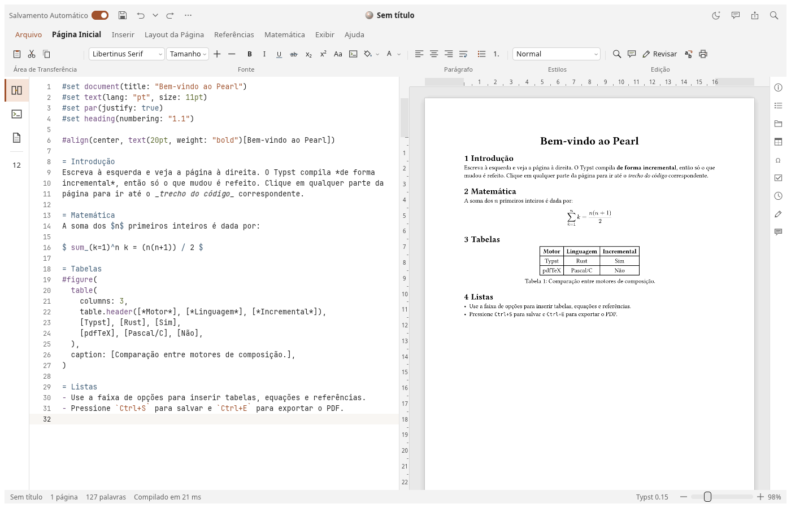
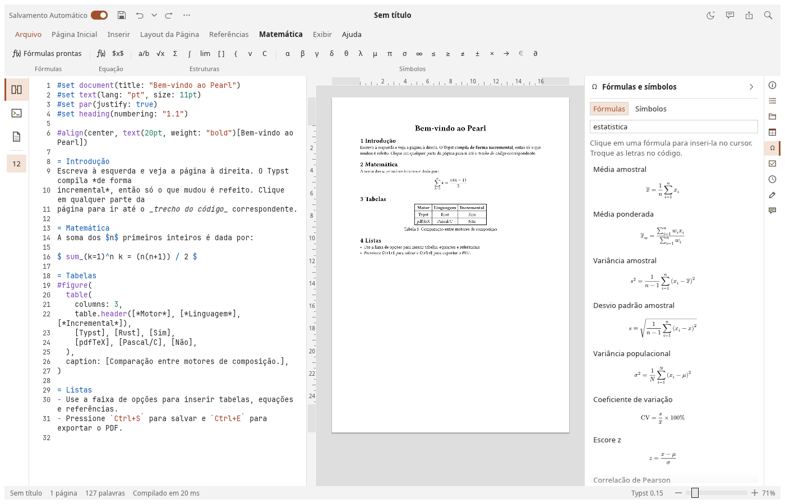
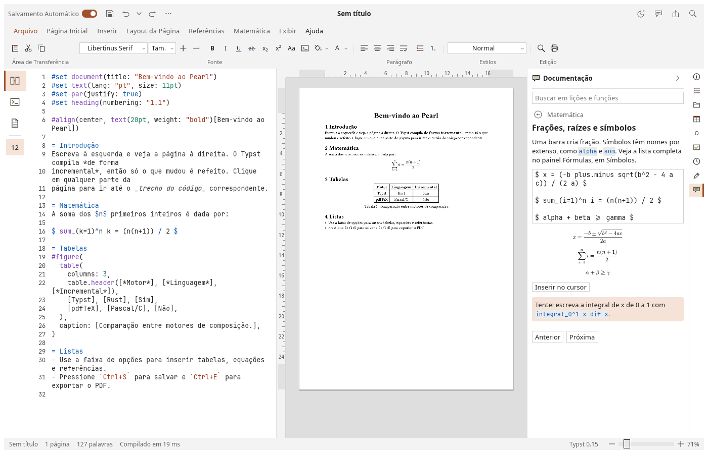
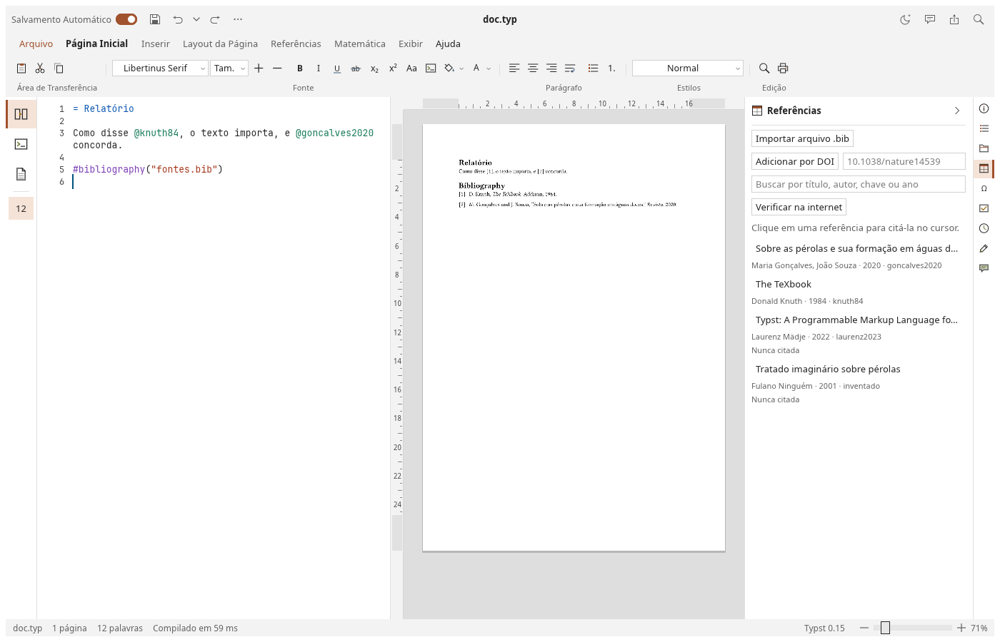
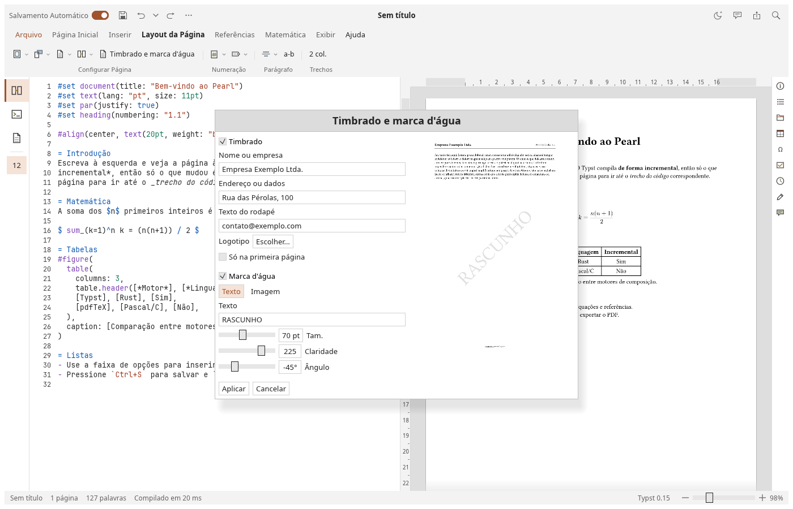
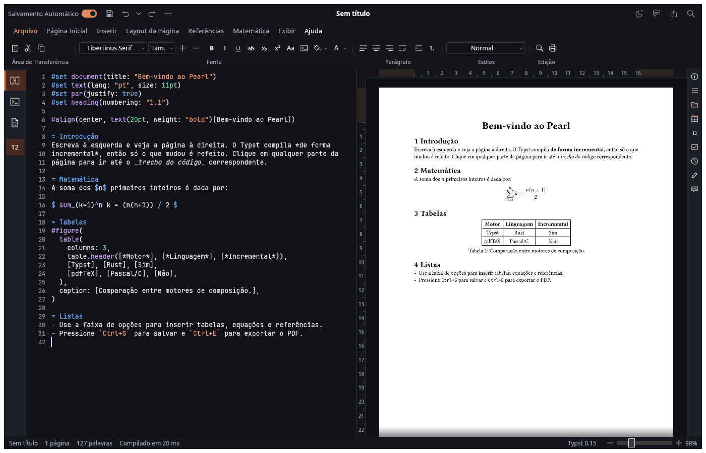
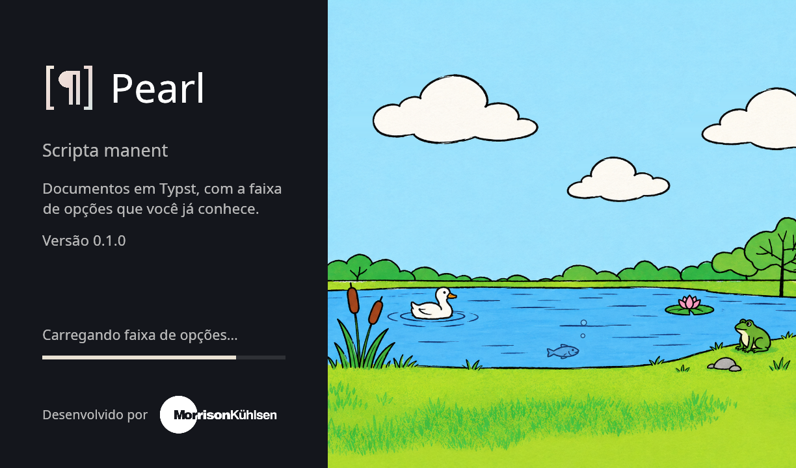

<h1 align="center">Pearl</h1>

<p align="center">
  <b>A document editor for Typst, in pure Rust: source on the left, live pages on the right, and a ribbon on top.</b>
</p>

<p align="center">
  Write in plain text or click on the page and type. Citations, formulas, figures and sessions with other
  people are all a click away, and the source stays the only thing that changes. It runs natively on Linux,
  Windows and macOS. <i>Scripta manent.</i>
</p>

<p align="center">
  
  
  
  
</p>

<br>

<p align="center">
  
</p>

<p align="center">
  <a href="#a-look-around">A look around</a> ·
  <a href="#what-it-does-today">What it does today</a> ·
  <a href="#quick-start">Quick start</a> ·
  <a href="#status">Status</a> ·
  <a href="#privacy">Privacy</a> ·
  <a href="#for-developers">For developers</a> ·
  <a href="#license-and-credits">License and credits</a>
</p>

## A look around

<table>
<tr>
<td width="50%" valign="top"><br><sub><b>Ready-made formulas</b>, with a preview and a search.</sub></td>
<td width="50%" valign="top"><br><sub><b>Documentation</b> with examples you can edit and see at once.</sub></td>
</tr>
<tr>
<td width="50%" valign="top"><br><sub><b>References</b>: a <code>.bib</code> or a DOI, a search and a click to cite.</sub></td>
<td width="50%" valign="top"><br><sub><b>Letterhead and watermark</b>, with a live preview.</sub></td>
</tr>
<tr>
<td width="50%" valign="top"><br><sub><b>Four themes</b>: system, light, dark and nacre.</sub></td>
<td width="50%" valign="top"><br><sub><b>The splash screen</b>, shown while the program loads.</sub></td>
</tr>
</table>

## What it does today

**Writing**
- Typst compiled inside the program, incrementally, with pages that follow as you type.
- Typing on the pages: a click puts the caret on that very letter, also with only the pages on show.
- Autocompletion, closing brackets, help on hover and search with its matches on show.
- Spell checking in Brazilian Portuguese, with suggestions on a right click.

**On the pages**
- Margins dragged on the rulers.
- Images selected, resized, moved to another paragraph or removed.
- Images pasted, dragged in or chosen from any folder, and copied beside the document.
- Each of these changes only the source, as one undo step.

**References and formulas**
- Import a `.bib`, paste a DOI, search, and click to cite. The bibliography is added when it's missing.
- Citations with no entry and entries never cited are shown as you write. On request, each reference is looked up at doi.org or Crossref.
- 98 ready-made formulas of algebra, trigonometry, geometry, calculus, linear algebra, statistics, probability, inference, finance and physics.

**Documents**
- Letterhead and watermark, from a window with a live preview.
- Templates, an outline, a files pane and PDF export.
- Version history: see what changed, compare two versions side by side on their finished pages, with what came in, went out or changed place marked, and restore.
- Autosave, and recovery of unsaved text after a crash.

**With others**
- Real-time sessions directly between host and guests, encrypted with the key in the link.
- Claude as a person in the session, with your own API key.

**Learning**
- 29 lessons in English and Brazilian Portuguese, with live examples.
- A searchable reference of every Typst function, from the documentation Typst carries inside itself, in English. F1 looks up the word at the caret.

The interface is in English and Brazilian Portuguese.

## Quick start

There are no released packages yet, so Pearl is built from source, with [Rust](https://rustup.rs) stable:

```sh
git clone https://github.com/morrisonkuhlsen/mkpearl
cd mkpearl
cargo run --release                  # opens the sample document, after the splash
cargo run --release -- paper.typ     # opens a file
cargo run --release -- --no-splash   # skips the splash
```

On Debian or Ubuntu, building needs:

```sh
sudo apt install pkg-config libxkbcommon-dev libwayland-dev libx11-dev libxcursor-dev \
  libxrandr-dev libxi-dev libfontconfig1-dev libfreetype-dev libssl-dev
```

A release workflow builds packages for Linux, Windows and macOS: see [`docs/releasing.md`](docs/releasing.md).

## Status

Pearl is early, at version 0.1.0, with nothing released yet. The tests drive the whole window, but much of it hasn't yet been tried by people on real machines ([#7](https://github.com/morrisonkuhlsen/mkpearl/issues/7)).

Worth knowing:
- Dragging files onto the window doesn't work under Wayland, a limit of the windowing library ([#15](https://github.com/morrisonkuhlsen/mkpearl/issues/15)). Pasting does.
- The rulers show one set of margins for the whole document ([#5](https://github.com/morrisonkuhlsen/mkpearl/issues/5)).
- Sessions connect directly, so across the internet they need a VPN or an open port ([#13](https://github.com/morrisonkuhlsen/mkpearl/issues/13)).
- Packages aren't signed, so Windows and macOS warn before opening them.

The plan is in [`docs/roadmap.md`](docs/roadmap.md).

## Privacy

Your documents stay on your computer. Pearl goes online only for what you ask of it:
- **Adding by DOI** sends the DOI to doi.org.
- **Check online** sends each reference's DOI or title to doi.org and Crossref.
- **Claude** sends what the conversation needs to Anthropic, with your own API key, which is stored only on your computer and never reaches a session's peers.
- **Sessions** go between the people in them, encrypted with the key in the link.
- **Typst packages** a document imports are downloaded from Typst's package repository.

## For developers

```sh
cargo xtask ci                        # every gate: fmt, clippy, tests, assets, panics
cargo test
cargo run --example shot -- out.png   # draws the window offscreen
```

See [`CONTRIBUTING.md`](CONTRIBUTING.md), [`docs/architecture.md`](docs/architecture.md) and, for agents, [`AGENTS.md`](AGENTS.md). Security reports go by [`SECURITY.md`](SECURITY.md).

## License and credits

A Morrison Kühlsen project, under [MIT](LICENSE-MIT) or [Apache-2.0](LICENSE-APACHE), at your choice. What it's built from keeps its own terms, listed in [`THIRD-PARTY-LICENSES.txt`](THIRD-PARTY-LICENSES.txt) and in the program under About. Among them, the font NewCM10-Regular, inside Typst, is under the GPL with a Distribution Exception, and spell checking uses `spellbook` and the VERO dictionary, under the MPL and LGPL. See [`NOTICE`](NOTICE) and [`ATTRIBUTION.md`](ATTRIBUTION.md).

The Morrison Kühlsen name and wordmark aren't covered by these licences: see [`docs/brand/LICENSE.md`](docs/brand/LICENSE.md).

Typesetting is done by [Typst](https://github.com/typst/typst). Pearl is not made or endorsed by the Typst project.
